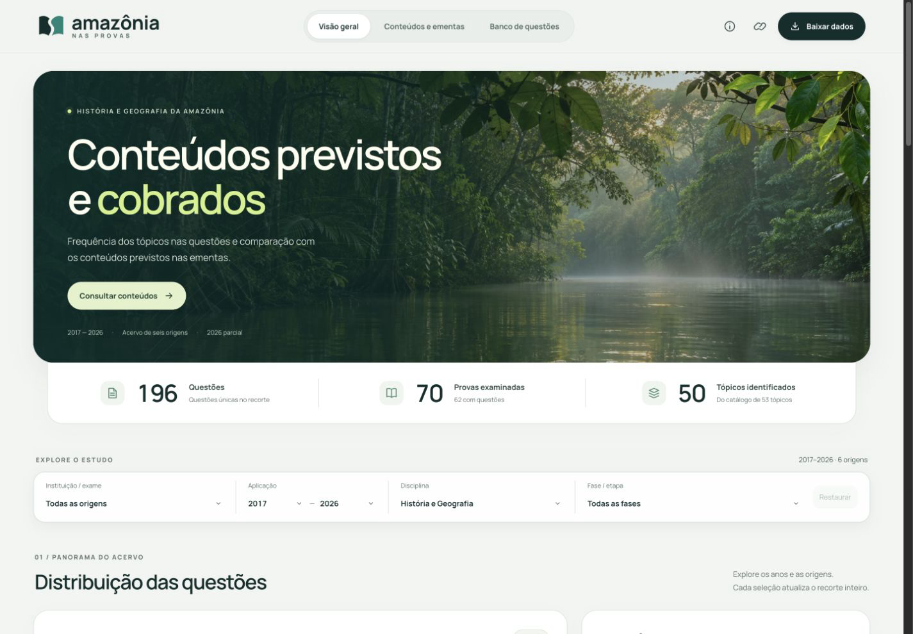

# História e Geografia da Amazônia nos vestibulares

[**Abrir dashboard interativo**](https://amazonia.mhvps.site) · [Análise exploratória](resultados/relatorio.md) · [Dataset curado](dados/curado/questoes.csv) · [Fontes](dados/fontes.csv) · [Revisão técnica e competências](docs/revisao-tecnica.md)

**Quanto do conteúdo previsto nas ementas realmente apareceu nas provas?** Este projeto reúne questões de História e Geografia da Amazônia, registra os vínculos disponíveis com o programa da respectiva prova e compara os tópicos previstos com a cobrança identificada. O repositório contém a coleta documental, as decisões de curadoria, a limpeza, a análise exploratória e o dashboard.

[](https://amazonia.mhvps.site)

O acervo tem **196 questões**, **70 provas examinadas**, **53 tópicos padronizados** e **151 referências documentais**, com aplicações entre 2017 e 11 de novembro de 2026. Nas **43 provas com programa regional integral e triagem completa**, identificamos cobrança em **141 de 682 pares prova × tópico previsto: 20,7%**. Essa proporção descreve o acervo comparável; não representa todos os vestibulares públicos brasileiros.

## Autoria e uso de IA

**Matheus Garcia** definiu o problema, o recorte e os requisitos de entrega e dirigiu as revisões do projeto. A pesquisa documental, a curadoria semântica e a implementação tiveram assistência de agentes no Codex. Essa atribuição não equivale a revisão humana item a item.

A IA participa de duas formas: no **desenvolvimento**, com código, revisão e assets; no **método**, com seleção das questões, classificação dos tópicos e associação aos programas. O código Python faz a limpeza e os cálculos de forma determinística. O dashboard consulta um JSON estático, sem modelo de IA em execução.

A reprodução verifica as decisões já registradas, não refaz a classificação por IA. O acervo conserva justificativas e referências, mas não os prompts analíticos, a identificação exata dos modelos ou as configurações das execuções. **Qualidade contra referência humana, horas economizadas, custos e impacto educacional não foram medidos.** A [revisão técnica](docs/revisao-tecnica.md) distingue essas lacunas das verificações de integridade e dos resultados reproduzidos.

## Resultados e recorte

O catálogo registra os conteúdos das ementas em uma taxonomia comum: disciplina → conteúdo → tópico. Os nomes originais, as páginas e as fontes continuam disponíveis. Cada questão tem um tópico principal e pode ter etiquetas adicionais. Há **50 tópicos presentes nas questões**, dos 53 catalogados, e **25 questões com tópicos de História e Geografia combinados**.

| Origem | Recorte examinado | Questões |
| --- | --- | ---: |
| UEA — Vestibular/Macro | Edições 2017–2026, Conhecimentos Gerais e Conhecimentos Específicos de Humanas | 107 |
| UFAM — PSC | Edições 2018–2026, três etapas, aplicadas dentro do recorte | 45 |
| Enem — Inep | Edições 2017–2025, aplicação regular impressa de Humanas | 17 |
| USP — FUVEST | Edições 2017–2026, História e Geografia da segunda fase | 8 |
| UERR | Vestibulares 2025/2026 | 10 |
| UFRR | Prova Integral 2025/2026 | 9 |

Cada fase ou etapa tem um identificador de prova, dentro do mesmo dataset. O ano é o da aplicação; edição e ingresso ficam em campos próprios. O número de provas varia por ano, e 2026 é parcial.

A comparação relacionada ao Novo Ensino Médio usa períodos do calendário de aplicação. As fases UEA seguem direções diferentes, e retirar 2026 muda a leitura da segunda fase. Sem trajetórias escolares ou respostas de candidatos, o estudo não identifica efeito da reforma nem mudança de dificuldade.

O [relatório](resultados/relatorio.md) apresenta a cobertura por prova e origem, os tópicos recorrentes, a série anual, os contrastes temporais descritivos e as análises de sensibilidade. As [tabelas de resultados](resultados/) conservam os denominadores e os identificadores que permitem conferir cada agregado.

## Reproduzir

Para a limpeza, os cálculos e a preparação do dashboard, use **Python 3.10 ou superior**, com a biblioteca padrão. Na raiz do repositório:

```sh
python3 scripts/limpeza.py
python3 scripts/analise.py
python3 scripts/preparar_dashboard.py
python3 -m unittest discover -s tests -v
python3 -O -m unittest discover -s tests -v
```

Esses comandos reconstroem o dataset curado, o relatório, as cinco tabelas de resultados e o JSON do dashboard. Funcionam sem internet e sem chamadas de IA. A classificação semântica já está registrada nos dados brutos; a reprodução aplica essas decisões.

Para testar os cálculos usados pelo navegador, com **Node.js 22 ou superior**:

```sh
node --test tests/test_dashboard.mjs
```

Os testes protegem a distinção entre zero e ausência de denominador, provas sem questões, vínculos pertinentes, sobreposição entre áreas e integridade das entradas. O [workflow de verificação](.github/workflows/verificar.yml) executa os testes Python/JavaScript e regenera as saídas tabulares no GitHub; falha se elas divergirem dos arquivos versionados. Não requer chaves de API nem chamadas pagas. As figuras são reproduzidas pelo comando separado abaixo.

Para consultar a interface local:

```sh
python3 -m http.server 8765 --directory dashboard
```

Abra [http://localhost:8765](http://localhost:8765). `preparar_dashboard.py` também copia os arquivos da interface para `dist/`, a saída usada pela hospedagem estática. O diretório gerado fica fora do Git e é reconstruído a cada execução; não armazene nele arquivos-fonte. Os detalhes da interface e dos assets estão no [README do dashboard](dashboard/README.md).

Para reproduzir as quatro figuras estáticas da análise, instale a dependência gráfica:

```sh
python3 -m venv .venv
.venv/bin/python -m pip install -r requirements.txt
.venv/bin/python scripts/figuras.py
```

O Matplotlib é necessário somente para as figuras; os cálculos tabulares usam a biblioteca padrão.

## Coleta e curadoria

O coletor recupera os documentos catalogados em `dados/fontes.csv` e confere o SHA-256 antes de aceitar cada PDF. Com `curl` instalado:

```sh
python3 scraping/coletar.py

# Opcional: extrair a camada textual dos PDFs; requer pdftotext/Poppler
python3 scraping/coletar.py --extrair
```

Os PDFs e o texto extraído ficam em `acervo/`, fora do Git. Arquivos íntegros são reaproveitados. Fontes sem documento recuperado permanecem identificadas como pendentes; a disponibilidade externa dos endereços não é necessária para reproduzir a análise.

Os agentes selecionaram questões cujo objeto é histórico ou geográfico amazônico. Instituição regional ou menção à Amazônia em um distrator não bastam. A [triagem](dados/brutos/triagem.csv) registra as decisões de inclusão e exclusão; as [questões brutas](dados/brutos/questoes.jsonl) registram a classificação antes da padronização final. Adicionar novas provas exige ampliar o catálogo e registrar a triagem e os vínculos programáticos antes de executar a limpeza.

A limpeza normaliza o texto, remove duplicatas exatas e verifica identificadores, hashes, fontes e relações. O arquivo `dados/curado/questoes.csv` é a entrada da análise; o JSON em `dashboard/` deriva dos CSVs canônicos por `preparar_dashboard.py`.

## Organização dos arquivos

<details>
<summary>Estrutura e função de cada arquivo</summary>

```text
scraping/       coleta dos documentos catalogados
scripts/        limpeza, análise, figuras e preparação do dashboard
dados/          catálogo, ementas, taxonomia, triagem e questões
resultados/     relatório, tabelas e quatro figuras da análise
dashboard/      interface, assets e dataset gerado para o navegador
tests/          verificações da limpeza e dos indicadores Python/JavaScript
docs/           revisão técnica, limites da IA e evidências para o portfólio
.github/        verificações automáticas de reprodução
```

| Arquivo | Função |
| --- | --- |
| `scraping/coletar.py` | Recupera os PDFs, verifica hashes e extrai texto quando solicitado. |
| `scripts/limpeza.py` | Padroniza as questões e verifica a integridade das relações. |
| `scripts/analise.py` | Gera o relatório e as cinco tabelas de frequências, cobertura, itens, séries e sensibilidades. |
| `scripts/figuras.py` | Gera os quatro PNGs a partir das tabelas de resultados. |
| `scripts/preparar_dashboard.py` | Converte os CSVs canônicos em JSON e prepara `dist/` para publicação. |
| `dados/fontes.csv` | URLs dos documentos, publicação institucional, origem e SHA-256. |
| `dados/provas.csv` | Provas, etapas, calendários e extensão da triagem e do programa. Inclui provas sem questões elegíveis. |
| `dados/topicos.csv` | Taxonomia e definição de cada tópico padronizado. |
| `dados/ementas.csv` | Itens dos programas com redação original, páginas e tópicos associados. |
| `dados/brutos/questoes.jsonl` | Questões selecionadas e decisões de curadoria antes da limpeza. |
| `dados/brutos/triagem.csv` | Itens examinados e decisões de inclusão ou exclusão. |
| `dados/curado/questoes.csv` | Dataset final: uma linha por questão, com enunciado, alternativas, tópicos e proveniência. |
| `resultados/relatorio.md` | Análise exploratória e resposta à pergunta do estudo. |
| `resultados/frequencia-topicos.csv` | Frequências principais e adicionais, anos, origens e cobrança dos tópicos previstos. |
| `resultados/previsto-cobrado.csv` | Cobertura dos tópicos e itens regionais por prova, com denominadores. |
| `resultados/itens-ementa.csv` | Itens dos programas e questões associadas, incluindo conteúdos sem cobrança identificada. |
| `resultados/temporal.csv` | Séries e períodos por origem, processo e etapa, com IDs das provas e denominadores. |
| `resultados/sensibilidade.csv` | Cobertura ao retirar anulações, foco misto ou aplicações de 2026. |
| `resultados/figuras/` | Figuras de cobertura, tópicos recorrentes, série UEA e contraste temporal. |
| `tests/test_estudo.py` | Testa limpeza, integridade, rejeição antes de gravar resultados, etapas e saída estática sem assets obsoletos. |
| `tests/test_dashboard.mjs` | Protege os cálculos JavaScript com casos do acervo congelado. |
| `.github/workflows/verificar.yml` | Executa testes e confere a reprodução das saídas versionadas. |
| `docs/revisao-tecnica.md` | Achados, validações, uso de IA, competências demonstradas e pendências. |
| `requirements.txt` | Versão do Matplotlib para reproduzir as figuras. |
| `dashboard/` | Código e documentação da interface; consulte o [detalhamento dos arquivos](dashboard/README.md). |
| `.openai/hosting.json` | Identidade do site e configuração da publicação estática. |
| `.gitignore` e `.gitattributes` | Excluem caches e saídas de publicação e padronizam os arquivos de texto. |

</details>

## Leitura dos dados e limites

`questao_id`, `prova_id`, `fonte_prova_id`, `topico_id` e `ementa_itens` relacionam questões, provas, documentos, tópicos e programas. Campos com várias referências usam `|`. As páginas são posições do PDF contadas a partir de 1. No JSON do dashboard, valores ausentes usam `null`.

`topico_id` indica a classificação principal; `topicos_ids` inclui as etiquetas adicionais. `disciplina`, `conteudo` e `topico` seguem o tópico principal. `disciplina_origem` preserva a identificação registrada na coleta. Frequências com etiquetas adicionais podem somar mais do que o total de questões.

A cobertura considera a união dos tópicos regionais explícitos de cada programa comparável. Um tópico previsto em cinco provas conta cinco vezes. Para contar cobrança, exigimos uma questão ligada ao item pertinente e ao tópico correspondente. Somamos os cobrados e os previstos; não fazemos a média dos percentuais por prova.

`tipo_vinculo_ementa` distingue vínculo direto, amplo e não localizado. Enem e FUVEST possuem vínculos programáticos amplos e ficam fora da proporção regional explícita. Ausência de vínculo não demonstra questão fora do edital. “—” significa denominador indisponível; zero exige um universo observado. As oito provas sem questões elegíveis continuam no cadastro.

A curadoria foi feita por agentes de IA e está identificada como tal. Os textos conservam as alternativas publicadas, inclusive distratores incorretos. Imagens, mapas e gráficos exigem consultar o PDF. Gabarito vazio significa não incorporado; as duas questões anuladas continuam no acervo por terem aparecido nos cadernos. O estudo não contém indicadores de desempenho dos candidatos.

Os programas UEA 2017 e dois editais PSC 2018 permanecem pendentes. A questão UEA 2026 Humanas Q05 tem um vínculo geral adicional em revisão, sinalizado no relatório e no dashboard; ele não modifica 141/682. A análise temporal é descritiva e não identifica efeitos causais de mudanças curriculares. O [relatório](resultados/relatorio.md) detalha as ressalvas e as fontes.

O histórico da pesquisa e da interface permanece no Git. Para uma apresentação curta e perguntas sobre as decisões técnicas, consulte a [revisão para o portfólio](docs/revisao-tecnica.md#apresentação-para-o-portfólio).
