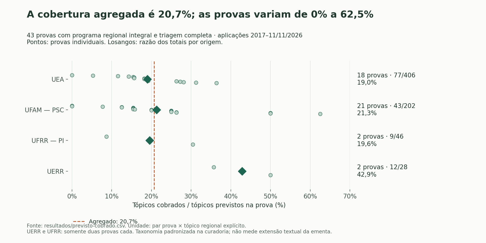
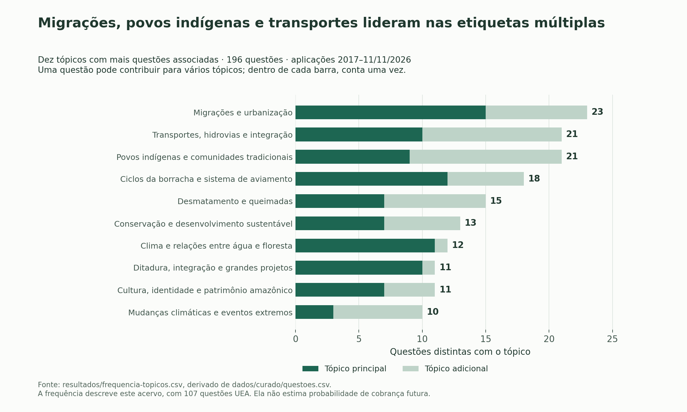
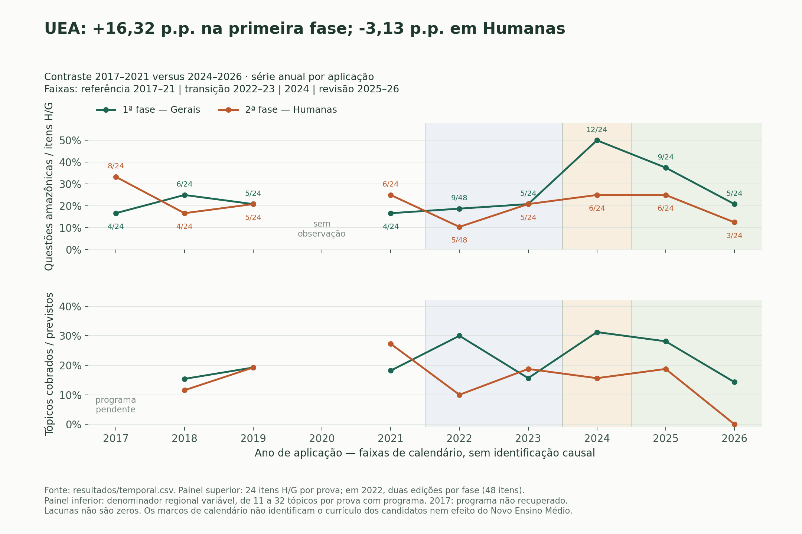
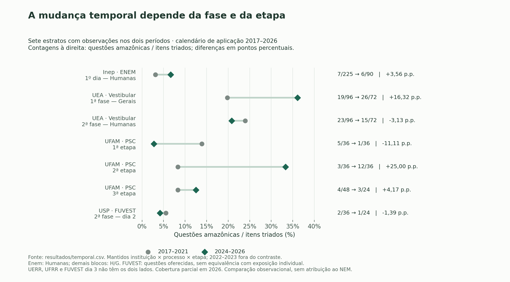

# História e Geografia da Amazônia nos vestibulares: conteúdos previstos e cobrados

## Resposta à pergunta do estudo

Nas **43 provas com programa regional integral e triagem completa**, a análise identificou cobrança de **141 dos 682 pares prova × tópico padronizado previstos nas ementas, ou 20,7%**. Essas provas reúnem 156 das 196 questões do banco.

A unidade de contagem é o par prova × tópico: um tópico previsto em cinco provas entra cinco vezes no denominador. Os conteúdos vêm das ementas; seus nomes, agrupamentos e desdobramentos seguem decisões de curadoria documentadas. O percentual depende desse nível de detalhamento e não mede extensão de texto, carga horária ou probabilidade de cobrança no próximo vestibular.

A análise também mostra concentração da frequência em alguns conteúdos e questões do recorte vinculadas a trechos gerais dos programas, sem referência regional explícita. Na UEA, entre 2017–2021 e 2024–2026, a proporção de questões do recorte entre os itens examinados aumenta na primeira fase e diminui na segunda. Essa diferença entre fases não sustenta uma mudança uniforme nem um efeito causal do Novo Ensino Médio (NEM).

## 1. Acervo, recorte e cobertura documental

O acervo contém **196 questões de História e Geografia da Amazônia**, selecionadas entre **1401 itens examinados** em **70 provas**. A triagem, que seleciona os itens que atendem ao recorte, identificou questões elegíveis em 62 provas e nenhuma nas outras 8. Dos 53 tópicos padronizados, 50 aparecem em ao menos uma questão. Como cada questão pode receber várias etiquetas de tópico, há 344 associações questão–tópico, sem aumento do total de questões.

| Origem | Provas examinadas | Itens triados | Questões do recorte | Provas com comparação de ementa | Cobertura por tópico |
| --- | --- | --- | --- | --- | --- |
| Inep | 9 | 405 | 17 | 0 | Não calculada |
| UEA | 20 | 480 | 107 | 18 | 77/406 (19,0%) |
| UERR | 2 | 36 | 10 | 2 | 12/28 (42,9%) |
| UFAM | 27 | 324 | 45 | 21 | 43/202 (21,3%) |
| UFRR | 2 | 36 | 9 | 2 | 9/46 (19,6%) |
| USP | 10 | 120 | 8 | 0 | Não calculada |

**Fontes:** [provas.csv](../dados/provas.csv), [questoes.csv](../dados/curado/questoes.csv) e [previsto-cobrado.csv](previsto-cobrado.csv).

O Enem conta como uma única origem, sem replicação por universidade que utiliza sua nota. A triagem abrange blocos de História e Geografia (H/G) na UEA e no PSC, Ciências Humanas no Enem e compilações de questões discursivas de H/G na FUVEST. Os denominadores de itens triados, portanto, não representam blocos idênticos.

O núcleo do acervo reúne as edições 2017–2026 do Vestibular/Macro da UEA, nas duas fases selecionadas, e as edições 2018–2026 do PSC, nas três etapas aplicadas dentro do recorte. O complemento inclui Enem regular impresso 2017–2025, segunda fase da FUVEST 2017–2026 e UERR/UFRR 2025/2026. Esse conjunto não constitui um censo nacional. Quando há cadernos equivalentes de cores diferentes, a seleção de uma cor por aplicação evita contar a mesma questão mais de uma vez. Os subitens discursivos permanecem agrupados na questão numerada.

A janela de análise vai de **01/01/2017 a 11/11/2026**, por ano de aplicação, com 2026 parcial. Edição, ingresso e aplicação precisam ser distinguidos: a edição UEA 2020 e o Enem 2020 foram aplicados em 2021; a UEA 2021, em 2022. Assim, a série contém duas edições da UEA aplicadas em 2022 e nenhuma observação da instituição em 2020.

| Ano de aplicação | Provas | Itens triados | Questões do recorte | Provas com programa comparável |
| --- | --- | --- | --- | --- |
| 2017 | 7 | 141 | 17 | 1 |
| 2018 | 7 | 141 | 19 | 5 |
| 2019 | 7 | 141 | 15 | 5 |
| 2020 | 1 | 12 | 1 | 0 |
| 2021 | 6 | 162 | 15 | 3 |
| 2022 | 11 | 213 | 29 | 9 |
| 2023 | 9 | 165 | 17 | 5 |
| 2024 | 8 | 159 | 35 | 5 |
| 2025 | 9 | 177 | 32 | 6 |
| 2026 | 5 | 90 | 16 | 4 |

A série anual completa está em [temporal.csv](temporal.csv), inclusive nos anos sem observação. Quando não há prova examinada, a proporção fica vazia; quando há prova examinada, mas nenhuma questão elegível, a proporção é zero. A variação dos totais anuais reflete, portanto, tanto a cobrança observada quanto a cobertura documental e os calendários de aplicação.

## 2. O que significa cobrir 20,7% da ementa?

O cálculo considera os tópicos associados a **cláusulas regionais explícitas**, trechos dos programas que mencionam de forma expressa conteúdos da região amazônica. Cada tópico entra uma única vez no denominador de cada prova comparável, mesmo que apareça em várias cláusulas. Um par prova × tópico entra no numerador quando há uma questão vinculada à cláusula pertinente e o tópico está associado a ambas. Uma questão sobre Acre/Petrópolis em 1903, por exemplo, não demonstra cobrança de um item exclusivo sobre Madri em 1750, embora ambos tratem de fronteiras.

As 43 provas com programas comparáveis pertencem à UEA, à UFAM, à UERR e à UFRR. O cálculo exclui as 19 provas nacionais com vínculo programático amplo; as duas fases da UEA 2017 e as etapas E1/E2 do PSC 2018, cujos programas estão pendentes; e quatro provas recentes do PSC E1 sem previsão regional explícita registrada. Quando falta um denominador regional, a cobertura não é calculada. Essa situação difere de uma cobertura igual a zero.



**Figura 1.** Cada ponto pequeno representa uma prova. O losango indica a razão entre os totais de pares prova × tópico cobrados e previstos em cada origem; a linha marca o agregado de 20,7%. UERR e UFRR contam com apenas duas provas cada. Fonte: [previsto-cobrado.csv](previsto-cobrado.csv). Reprodução: `python scripts/figuras.py`.

A cobertura por prova varia de 0,0% a 62,5%, com mediana de 18,8% e média simples de 21,6%. A razão agregada de 141/682 dá mais peso às provas com mais tópicos previstos; a média simples atribui o mesmo peso a cada prova.

A contagem por cláusula usa outra unidade: **240 dos 849 registros de cláusulas regionais transcritas (28,3%)** têm algum vínculo com questões. Como uma cláusula pode reunir vários tópicos, o vínculo não demonstra cobrança de todo o seu conteúdo. Ao exigir também uma etiqueta de tópico em comum, o total cai para **228/849 (26,9%)**: 12 registros têm vínculos sem etiquetas compartilhadas. Essa divergência entre vínculo semântico e classificação por tópico merece revisão; a cobertura por pares prova × tópico continua sendo o indicador principal. A redação original das cláusulas e suas correspondências estão em [itens-ementa.csv](itens-ementa.csv).

| Área dos tópicos | Pares cobrados | Pares previstos | Cobertura (%) |
| --- | --- | --- | --- |
| História | 75 | 410 | 18,3 |
| Geografia | 66 | 272 | 24,3 |

A diferença entre História e Geografia depende da taxonomia, isto é, da organização dos tópicos adotada na curadoria, e dos programas observados. Uma questão interdisciplinar pode contribuir com tópicos das duas áreas sem ser contada duas vezes no banco.

### Zero de cobertura não é ausência de questão regional

Das 196 questões, 52 estão ligadas apenas a cláusulas gerais, 90 apenas a cláusulas regionais explícitas, 38 a ambas e 16 não têm item localizado. Essa divisão descreve o escopo das cláusulas. Ela difere dos rótulos usados para registrar a força do vínculo entre questão e programa: direto, amplo e não localizado.

A segunda fase de Humanas da UEA 2026 exemplifica essa distinção: há **três questões do recorte e 0/14 tópicos regionais explícitos cobrados**. As questões tratam de independência no Pará (Q05, p. 3), terra preta (Q13, p. 5) e rios voadores (Q16, p. 7). Seus vínculos pertinentes são cláusulas gerais: “Revoluções e independências nas Américas” (programa, p. 8), “Solo.” e “A dinâmica climática da Terra” (p. 9). O zero se refere à cobertura dos tópicos regionais explícitos; não demonstra ausência de questões do recorte nem cobrança fora do edital.

| Fase/etapa | Provas | Questões | Questões/prova | Programas comparáveis | Pares cobrados/previstos | Cobertura (%) |
| --- | --- | --- | --- | --- | --- | --- |
| UEA — Vestibular — 1ª fase — Conhecimentos Gerais | 10 | 59 | 5,90 | 9 | 46/203 | 22,7 |
| UEA — Vestibular — 2ª fase — Humanas | 10 | 48 | 4,80 | 9 | 31/203 | 15,3 |
| UFAM — PSC — 1ª etapa | 9 | 12 | 1,33 | 4 | 11/32 | 34,4 |
| UFAM — PSC — 2ª etapa | 9 | 21 | 2,33 | 8 | 22/122 | 18,0 |
| UFAM — PSC — 3ª etapa | 9 | 12 | 1,33 | 9 | 10/48 | 20,8 |

As duas fases da UEA permanecem no mesmo conjunto de dados, identificadas como provas distintas. Os blocos triados contêm 24 itens de H/G por fase, enquanto cada etapa do PSC tem 12. A contagem de questões por prova deve ser lida à luz dessa diferença e não mede profundidade ou dificuldade.

## 3. Frequência dos tópicos e conteúdos sem cobrança vinculada

Os cinco tópicos mais frequentes na classificação principal reúnem **58/196 questões (29,6%)**. Nessa classificação, cada questão recebe um único tópico principal. As etiquetas adicionais registram conexões com outros assuntos e permitem examinar a frequência de um tópico em todas as questões às quais ele se aplica.



**Figura 2.** Cada barra conta as questões distintas associadas ao tópico. O segmento escuro indica quantas o têm como tópico principal. Como uma questão pode ter várias etiquetas, a soma das contagens entre tópicos pode superar 196. Período: aplicações de 2017 a 11/11/2026. Fontes: [frequencia-topicos.csv](frequencia-topicos.csv) e [questoes.csv](../dados/curado/questoes.csv).

| Tópico principal | Questões em que é principal | Total de questões com o tópico | Provas em que é principal |
| --- | --- | --- | --- |
| Migrações e urbanização | 15 | 23 | 12 |
| Ciclos da borracha e sistema de aviamento | 12 | 18 | 11 |
| Clima e relações entre água e floresta | 11 | 12 | 11 |
| Transportes, hidrovias e integração | 10 | 21 | 10 |
| Ditadura, integração e grandes projetos | 10 | 11 | 8 |
| Povos indígenas e comunidades tradicionais | 9 | 21 | 8 |
| Desmatamento e queimadas | 7 | 15 | 7 |
| Conservação e desenvolvimento sustentável | 7 | 13 | 6 |
| Reformas pombalinas e Diretório dos Índios | 7 | 7 | 7 |
| Cultura, identidade e patrimônio amazônico | 7 | 11 | 7 |
| Mineração e garimpo | 6 | 9 | 6 |
| Produção familiar e economia solidária | 6 | 7 | 4 |

O tópico Migrações e urbanização é o mais frequente na classificação principal. Incluindo as etiquetas adicionais, o tópico Povos indígenas e comunidades tradicionais aparece em 21 questões, distribuídas por 20 provas e pelas seis origens do banco. A composição do acervo influencia essas frequências: a UEA responde por 107 das 196 questões. A recorrência observada não permite estimar a probabilidade de cobrança futura.

As associações entre tópicos também mostram conexões entre processos históricos e geográficos. A questão `uea2017-geral-q19` (p. 10), sobre um caucheiro, relaciona borracha e deslocamentos; `uea-2025-ce-q19` (p. 8) pede a leitura de saldo migratório e tipos de migração. Esses exemplos ilustram os conteúdos cobrados, sem permitir inferências sobre mudança de dificuldade.

A tabela seguinte reúne tópicos sem cobrança vinculada nas provas que os previram de forma explícita. A última coluna mostra suas ocorrências em todo o banco, inclusive fora dessas provas.

| Tópico sem cobrança vinculada | Provas com previsão explícita | Questões com o tópico em todo o banco |
| --- | --- | --- |
| Primeira República na Amazônia | 15 | 2 |
| Delimitações e regionalização da Amazônia | 11 | 1 |
| Drogas do sertão e economia colonial | 9 | 4 |
| Economia regional e organização da produção | 6 | 0 |
| Populismo e democracia na Amazônia | 6 | 0 |
| Coronelismo, clientelismo e poder regional | 6 | 0 |
| Comércio fluvial e regatões | 2 | 4 |
| Questão do Acre e Tratado de Petrópolis | 2 | 2 |

Primeira República aparece em questões nacionais, mas não tem cobrança vinculada nas 15 provas com previsão regional explícita. Acre/Petrópolis aparece em duas questões do banco, ambas fora das duas provas que o previram de forma explícita. Já populismo, coronelismo e organização da produção não têm etiqueta em nenhuma questão coletada; as seis previsões de cada tópico correspondem às duas fases de três edições da UEA. A ausência de cobrança identificada no acervo não justifica excluir esses conteúdos da preparação.

## 4. História, Geografia e interdisciplinaridade

A classificação pelo tópico principal distribui as questões em **87 de História e 109 de Geografia**. Quando se considera o conjunto de etiquetas, são **67 somente de História, 104 somente de Geografia e 25 com ambas as áreas**. A presença de etiquetas das duas áreas define a interdisciplinaridade neste estudo; essa classificação não corresponde a uma anotação oficial das bancas.

A disciplina de origem registra 83 questões como História e 113 como Geografia. Em seis questões, a área do tópico principal difere da disciplina de origem; o banco preserva os dois campos para permitir essa comparação.

“Foco regional misto” descreve outra característica: a presença de conteúdo amazônico substantivo em um contexto mais amplo. As 19 questões com esse rótulo constituem um conjunto diferente das 25 classificadas como interdisciplinares em H/G. Nenhuma dessas distinções altera o total de questões.

## 5. O que mudou no tempo, em torno do Novo Ensino Médio?

### Períodos e limites da comparação

A comparação é **observacional e segue o calendário de aplicação das provas**. O plano temporal distingue quatro faixas: **2017–2021**, **2022–2023**, **2024** e **2025–2026**. O contraste principal compara 2017–2021 com 2024–2026 e exclui 2022–2023. A análise de sensibilidade sem 2026, usada para verificar quanto esse ano influencia o resultado, considera 2024–2025 como período posterior. Esses cortes constam da seção 6 do protocolo histórico, acessível com `git show 3f044af^:docs/protocolo.md`. O período de referência antecede o cronograma geral de implementação, mas pode incluir experiências-piloto ou implantações locais.

A [Lei 13.415/2017, art. 12](https://www2.camara.leg.br/legin/fed/lei/2017/lei-13415-16-fevereiro-2017-784336-publicacaooriginal-152003-pl.html) estabelece um marco legal, mas não demonstra mudança simultânea nas redes de ensino. O cronograma original da [Portaria MEC 521/2021, art. 4º](https://www.seduc.pa.gov.br/site/public/upload/arquivo/probncc/PORTARIA%20N%C2%BA%20521%2C%20DE%2013%20DE%20JULHO%20DE%202021-e03b6.pdf) previa implementação na primeira série em 2022, nas duas primeiras em 2023 e em todas em 2024. Segundo esse cronograma, um grupo de estudantes que iniciou o ensino médio em 2022 chegaria à terceira série em 2024. Essa inferência normativa não comprova a trajetória escolar de quem prestou as provas.

A [suspensão de prazos em 2023](https://www.gov.br/secom/pt-br/assuntos/obrasilvoltou/cuidado/cronograma-de-implementacao-do-novo-ensino-medio-e-suspenso) também não comprova paralisação uniforme da implantação. A [Lei 14.945/2024, art. 5º, II](https://www2.camara.leg.br/legin/fed/lei/2024/lei-14945-31-julho-2024-796017-publicacaooriginal-172512-pl.html) prevê o início da revisão em 2025. As [Diretrizes Curriculares Nacionais para o Ensino Médio (DCNEM) 2/2024, arts. 39 e 42, pp. 23–24](https://www.seduc.pa.gov.br/site/public/upload/arquivo/probncc/RESOLUCAO%20CNE-CEB%202-2024-f599f.pdf) permitem transições e coexistência curricular; os ingressantes mencionados nesses artigos são do ensino médio. Por isso, 2025–2026 não pode ser tratado como um período curricular homogêneo.

No Enem, o [Edital 52/2025, item 3.1](https://download.inep.gov.br/enem/edital_52_de_23_de_maio_de_2025.pdf), também publicado no [DOU de 23/05/2025, seção 3 extra, p. 1](https://pesquisa.in.gov.br/imprensa/servlet/INPDFViewer?captchafield=firstAccess&data=23%2F05%2F2025&jornal=608&pagina=1), ainda remete à matriz de referência histórica. O ano de aplicação, por si só, não justifica classificar as questões do Enem 2024 como parte de um novo formato curricular. Implantação escolar, currículo cursado por um candidato e alteração da matriz da prova são variáveis distintas.

### As fases da UEA seguem direções diferentes



**Figura 3.** O painel superior mostra a proporção de questões do recorte entre os itens de H/G triados. O inferior mostra a cobertura dos tópicos regionais explícitos, calculada pela razão entre pares prova × tópico cobrados e previstos. A lacuna de 2020 indica ausência de aplicação observada; em 2022, há duas edições por fase. As faixas representam períodos do calendário, sem atribuição causal ao currículo. Fonte: [temporal.csv](temporal.csv).

| Período de aplicação | UEA — primeira fase | UEA — segunda fase de Humanas |
| --- | --- | --- |
| 2017–2021 | 19/96 (19,8%) | 23/96 (24,0%) |
| 2022–2023 | 14/72 (19,4%) | 10/72 (13,9%) |
| 2024 | 12/24 (50,0%) | 6/24 (25,0%) |
| 2025–2026 | 14/48 (29,2%) | 9/48 (18,8%) |
| 2024–2026 | 26/72 (36,1%) | 15/72 (20,8%) |
| 2024–2025 | 21/48 (43,8%) | 12/48 (25,0%) |

Entre 2017–2021 e 2024–2026, a proporção de questões do recorte na primeira fase passa de **19/96 (19,8%)** para **26/72 (36,1%)**, diferença de **+16,32 pontos percentuais (p.p.)**. Na segunda, passa de **23/96 (24,0%)** para **15/72 (20,8%)**, diferença de **−3,13 pontos percentuais**. São quatro provas por fase na referência e três no período posterior. O agregado sobe de 42/192 para 41/144 (+6,60 pontos percentuais), ocultando as direções distintas. Sem 2026, a segunda fase fica em 12/48 (25,0%): a redução deixa de aparecer.

A cobertura da ementa exige considerar também as mudanças nos programas. Por edição, cada fase da UEA tem 26 tópicos previstos em 2018/2019, 11 em 2020/2021, 19 em 2022, 32 em 2023–2025 e 14 em 2026; o programa de 2017 está ausente. Nos programas disponíveis, a cobertura passa de 22/126 (17,5%) em 2017–2021 para 32/156 (20,5%) em 2024–2026. A comparação restrita aos tópicos previstos de forma explícita em **todas** as provas da UEA com programas comparáveis nesses dois períodos produz outro resultado:

| Período | Provas com programa | Tópicos comuns por prova | Pares cobrados/previstos | Cobertura (%) |
| --- | --- | --- | --- | --- |
| 2017–2021 | 6 | 4 | 4/24 | 16,7 |
| 2024–2026 | 6 | 4 | 4/24 | 16,7 |

Os tópicos comuns são G04 — Hidrografia e dinâmica fluvial, G09 — Conservação e desenvolvimento sustentável, H02 — Sociedades indígenas antes da conquista e H16 — Zona Franca de Manaus e industrialização. Com esse conjunto fixo, a cobertura permanece estável, enquanto a comparação com todos os tópicos dos programas indica aumento. Nenhuma dessas medidas, isoladamente, identifica um efeito do NEM.

| Tópico comum | Provas com cobrança / com previsão em 2017–2021 | Provas com cobrança / com previsão em 2024–2026 |
| --- | --- | --- |
| Hidrografia e dinâmica fluvial | 2/6 | 0/6 |
| Conservação e desenvolvimento sustentável | 1/6 | 3/6 |
| Sociedades indígenas antes da conquista | 1/6 | 0/6 |
| Zona Franca de Manaus e industrialização | 0/6 | 1/6 |

Embora a cobertura agregada permaneça igual, os tópicos cobrados mudam: hidrografia e sociedades indígenas deixam de ter ocorrências nesse conjunto, enquanto conservação aparece em mais provas e Zona Franca passa a aparecer.

### Comparação entre os mesmos processos e etapas

Para reduzir diferenças de composição entre períodos, a análise também compara os mesmos estratos: grupos definidos pela combinação de instituição, processo seletivo e fase ou etapa. Esse painel inclui apenas os grupos com observações nos dois períodos.



**Figura 4.** Comparação entre 2017–2021 e 2024–2026. Cada linha corresponde a uma combinação de instituição × processo × etapa presente nos dois períodos. Os números ao lado indicam questões do recorte/itens triados. FUVEST dia 3, UERR e UFRR ficam fora desse painel por não terem observações em um dos períodos. Fonte: [temporal.csv](temporal.csv).

| Estrato | 2017–2021 | 2024–2026 | Diferença (p.p.) |
| --- | --- | --- | --- |
| Inep — Enem — 1º dia — Humanas | 7/225 (3,1%) | 6/90 (6,7%) | 3,56 |
| UEA — Vestibular — 1ª fase — Conhecimentos Gerais | 19/96 (19,8%) | 26/72 (36,1%) | 16,32 |
| UEA — Vestibular — 2ª fase — Humanas | 23/96 (24,0%) | 15/72 (20,8%) | -3,13 |
| UFAM — PSC — 1ª etapa | 5/36 (13,9%) | 1/36 (2,8%) | -11,11 |
| UFAM — PSC — 2ª etapa | 3/36 (8,3%) | 12/36 (33,3%) | 25,00 |
| UFAM — PSC — 3ª etapa | 4/48 (8,3%) | 3/24 (12,5%) | 4,17 |
| USP — FUVEST — 2ª fase — dia 2 | 2/36 (5,6%) | 1/24 (4,2%) | -1,39 |

No PSC, a proporção diminui na primeira etapa e aumenta na segunda. As contagens de questões do recorte no período posterior do Enem e da FUVEST são pequenas, o que limita a leitura das diferenças. A análise separa o dia 2 da FUVEST do antigo dia 3 para preservar a etapa documentada. Além disso, o total de questões discursivas oferecidas não significa que cada candidato tenha respondido a todos os componentes.

| Conjunto | Período | Provas | Questões do recorte/itens triados | Razão global (%) | Média por prova (%) | Média dos mesmos estratos (%) |
| --- | --- | --- | --- | --- | --- | --- |
| acervo inteiro | 2017–2021 | 28 | 67/597 | 11,2 | 12,2 | — |
| acervo inteiro | 2024–2026 | 22 | 83/426 | 19,5 | 19,6 | — |
| acervo inteiro | 2024–2025 | 17 | 67/336 | 19,9 | 20,3 | — |
| painel comum | 2017–2021 | 26 | 63/573 | 11,0 | 11,8 | 11,9 |
| painel comum | 2024–2026 | 18 | 64/354 | 18,1 | 18,1 | 16,6 |
| painel comum | 2024–2025 | 14 | 53/282 | 18,8 | 19,1 | 19,1 |

As três medidas atribuem pesos diferentes às observações. A razão global pondera os blocos pelo número de itens; a média por prova dá o mesmo peso a cada prova; e a média dos mesmos estratos atribui peso igual aos sete grupos comuns. UERR e UFRR entram apenas no cálculo de todo o acervo. Por resumirem conjuntos e ponderações diferentes, esses agregados devem acompanhar a leitura por processo e etapa.

Nos processos seriados, uma aproximação dos cortes por série usa E1/2022, E2/2023 e E3/2024. A análise de sensibilidade a seguir aplica esses cortes ao **calendário**, mantendo as etapas separadas:

| Etapa PSC | Antes do corte | A partir do corte |
| --- | --- | --- |
| PSC — 1ª etapa | Antes de 2022: 5/36 (13,9%) | A partir de 2022: 7/72 (9,7%) |
| PSC — 2ª etapa | Antes de 2023: 7/60 (11,7%) | A partir de 2023: 14/48 (29,2%) |
| PSC — 3ª etapa | Antes de 2024: 9/84 (10,7%) | A partir de 2024: 3/24 (12,5%) |

Esses cortes não identificam o currículo cursado pelos candidatos. O PSC 2021 E1/E2 foi aplicado em 2022 com série-alvo anterior, e o PSC 2026 E2 foi aplicado em 2026 para a série-alvo de 2025. Sem dados de trajetória escolar e evidência de implantação local vinculada aos candidatos, a base não permite comparar coortes reais de exposição curricular. Os resultados estão em `temporal.csv`, no tipo `corte seriado`, e se limitam à divisão por calendário.

## 6. Robustez e conferência dos indicadores

A análise de sensibilidade verifica quanto a cobertura muda ao excluir questões anuladas, restringir o foco regional ou retirar o ano parcial de 2026.

| Cenário | Questões no banco | Questões nas comparáveis | Provas comparáveis | Pares cobrados/previstos | Cobertura (%) |
| --- | --- | --- | --- | --- | --- |
| Base | 196 | 156 | 43 | 141/682 | 20,7 |
| Sem anuladas | 194 | 154 | 43 | 138/682 | 20,2 |
| Somente foco central | 177 | 145 | 43 | 132/682 | 19,4 |
| Central sem anuladas | 175 | 143 | 43 | 129/682 | 18,9 |
| Sem 2026 | 180 | 140 | 39 | 131/621 | 21,1 |

Nos quatro primeiros cenários, o cálculo mantém as provas e o denominador original, mesmo quando a exclusão deixa uma prova sem questões elegíveis. O cenário “Sem 2026” altera a janela e, com ela, o conjunto de programas. Essas exclusões são simulações em memória e não modificam os dados curados. Fonte: [sensibilidade.csv](sensibilidade.csv).

As questões com anulação conhecida são `ufam-psc2021-e1-q21` e `uerr-vestibular2025-q57`. Elas permanecem na análise principal porque constam dos cadernos aplicados. A exclusão dessas duas questões, porém, não produz uma medida dos itens válidos para pontuação: há **129 campos de gabarito vazios**, incluindo oito questões discursivas. A análise não presume a validade dos demais itens, nem usa IA para preencher respostas ausentes.

A conferência encontrou 0 identificadores (IDs) repetidos e 0 hashes de texto limpo repetidos. O hash funciona como uma assinatura do conteúdo, usada aqui para detectar textos idênticos. A combinação de prova e número da questão também é única, e os totais de triagem coincidem com o cadastro e a seleção.

Entre as 16 questões sem vínculo localizado com a ementa, 14 dependem de programas pendentes e duas não têm associação pertinente identificada. Em 111 questões, falta a data completa de aplicação. Essas datas não foram preenchidas por suposição; o cadastro conserva o ano e a evidência que o sustenta.

### Divergências e alcance da verificação

A questão `uea-2026-ce-q05` (Pará, 1823, prova, p. 3) contém um vínculo adicional ao item `uea-vest2026-ce__uea-vest2026-historia-027` (“Império Brasileiro: 2º Reinado.”, programa, p. 8). Esse vínculo é cronologicamente inadequado. A análise do exemplo considera o item H024 (“Revoluções e independências nas Américas”), que também está registrado. A retirada simulada de H027 não altera 141/682 nem 0/14, pois o item tem escopo geral. O registro curado permanece preservado, com essa ressalva para revisão.

Na descrição, os tipos de resposta `objetiva` e `objetiva_multipla_escolha` pertencem à mesma família; o banco mantém os valores originais. As diferenças entre disciplina de origem e área do tópico principal estão documentadas e não decorrem de erros de soma. A conferência quantitativa confirma o cálculo do indicador principal, mas não substitui a validação humana integral da curadoria feita por agentes de IA.

## 7. Limitações e recomendações de uso

A cobertura dos programas é parcial, com recorrência de alguns tópicos e trajetórias temporais distintas entre fases e etapas. Os tópicos sem cobrança identificada permanecem no conjunto de conteúdos que podem ser exigidos.

A interpretação da cobertura depende do recorte regional explícito, da taxonomia e da janela de análise. Mudanças de ementa, efeitos da pandemia, formato das provas, banca e disponibilidade documental podem acompanhar as diferenças observadas, mas a análise não isola suas contribuições. A base não contém respostas comparáveis de candidatos, medida de procura por curso ou classificação sistemática de demanda cognitiva. Por isso, não permite concluir que as provas ficaram mais difíceis, que a reforma causou mudanças ou que houve alteração na aprendizagem.

Para uma plataforma educacional, recomenda-se organizar a navegação por disciplina → conteúdo → tópico, com múltiplas etiquetas e filtros de prova e etapa. A frequência deve aparecer junto ao número de provas observadas, sem excluir conteúdos previstos que não tiveram ocorrência nem questões vinculadas a cláusulas gerais. Antes de usar o banco para correção automática, é necessário completar os gabaritos ausentes, revisar as decisões semânticas e disponibilizar os recursos visuais originais nas páginas indicadas. Essas recomendações orientam o uso do acervo; não constituem resultados sobre desempenho.

A cobertura documental permanece incompleta: faltam os programas da UEA 2017 e do PSC 2018 E1/E2. O Enem 2026 teve o [primeiro dia aplicado em 08/11/2026](https://www.gov.br/inep/pt-br/centrais-de-conteudo/noticias/enem/participantes-concluem-primeiro-dia-do-enem-2026), mas seu PDF oficial não foi localizado na consulta. Essa ausência não equivale a uma edição com zero questões do recorte. Enem PPL, digital, reaplicações e outras variantes também ficam fora do estudo.

O catálogo contém 151 referências de fonte, das quais 149 têm hash do PDF recuperado, e distingue publicações institucionais de cópias públicas identificadas. O texto e as alternativas preservam os distratores, inclusive as afirmações falsas das questões originais. Imagens, mapas e gráficos exigem consulta ao PDF. A curadoria semântica foi realizada por agentes de IA e está sujeita às limitações de validação descritas na seção anterior.

## 8. Reprodução e referências dos resultados

O [README](../README.md) reúne as regras de inclusão, o dicionário dos campos centrais e os comandos de execução. As definições operacionais atuais estão nele e neste relatório. O protocolo e o dicionário anteriores foram consultados no histórico do Git, onde continuam disponíveis. As bases em `dados/` são as entradas da análise; o código aplica as classificações registradas, sem refazer a curadoria.

Os comandos abaixo reproduzem os cálculos e as figuras. O relatório é um documento editorial mantido separadamente: executar a análise não cria nem sobrescreve este arquivo.

```sh
python3 scripts/analise.py
python3 -m unittest discover -s tests -v
python3 -m venv .venv
.venv/bin/python -m pip install -r requirements.txt
.venv/bin/python scripts/figuras.py
```

O cálculo tabular usa apenas Python 3.10+ e a biblioteca padrão. As quatro figuras PNG dependem da versão do Matplotlib indicada em [requirements.txt](../requirements.txt) e dispensam acesso à internet após a instalação. O script `scripts/analise.py` gera cinco tabelas e mantém os indicadores complementares na função `consolidar_resultados`; `scripts/figuras.py` lê as tabelas e produz as imagens. As figuras informam unidade, período, denominador e fonte, e a matriz temporal conserva os IDs das provas para permitir a conferência de cada agregado.

| Evidência | Fonte de reprodução |
| --- | --- |
| Universo, cobertura e calendários | `dados/provas.csv`, `dados/fontes.csv`, `resultados/temporal.csv` |
| Texto, área, anulação, tópicos e exemplos | `dados/curado/questoes.csv`, PDF e página registrados |
| Conteúdo previsto e padronização | `dados/ementas.csv`, `dados/topicos.csv`, `resultados/itens-ementa.csv` |
| Razão principal e diferenças entre provas | `resultados/previsto-cobrado.csv` |
| Frequências e zeros condicionais | `resultados/frequencia-topicos.csv` |
| Série anual, períodos e painel comum | `resultados/temporal.csv` |
| Anulações, foco regional e exclusão de 2026 | `resultados/sensibilidade.csv` |

As referências dos marcos curriculares estão na seção temporal, com links para as fontes primárias e indicação de artigo ou página. Essas fontes contextualizam os cortes; as contagens de questões e programas vêm dos arquivos do acervo. Consulta documental: 11/11/2026.
